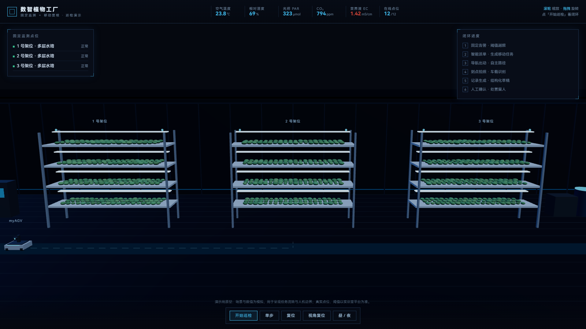
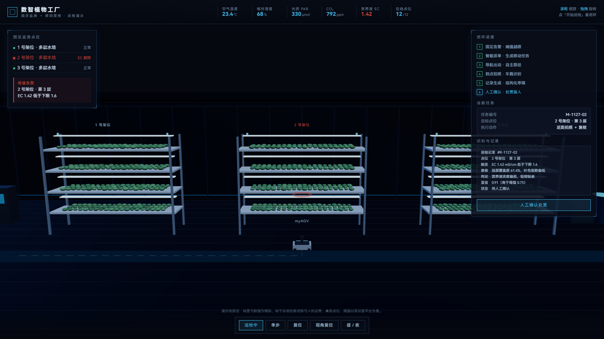
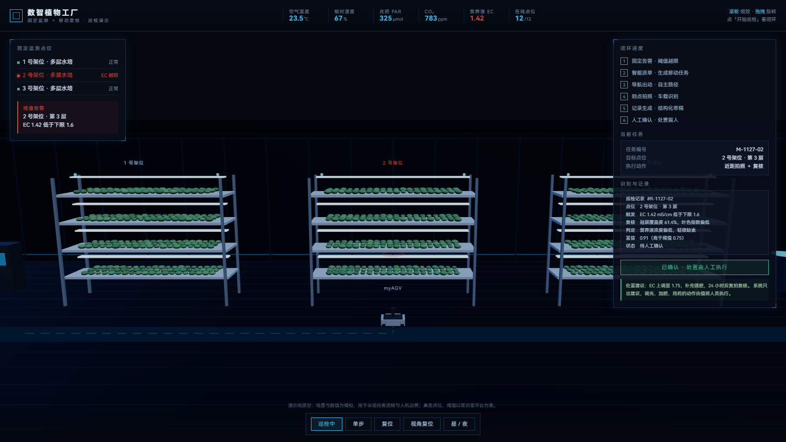

# 数智植物工厂 · 固定监测 ＋ 移动复核 智能巡检

把固定传感器的告警，接上移动小车的到点复核，让「发现异常」和「确认异常」接成一条线。

广西农业职业技术大学 信息工程学院 · 网络工程技术（本）2502 · 覃祖悦
人工智能课程 任务二（项目设计练习）配套 demo

**在线预览**：https://medianigray.github.io/plant-factory-inspection-demo/
**仓库地址**：https://github.com/MedianiGray/plant-factory-inspection-demo



<table>
<tr>
<td></td>
<td></td>
</tr>
</table>

---

## 这是什么

一个单文件网页演示，双击 `index.html` 即开，**不需要联网**（3D 渲染库已内嵌在文件里），拷到 U 盘、换台电脑都能跑。

场景取材于实训室的数智植物工厂：多层立体水培（NFT 浅液流）、3 个架位、每架 4 层、全光谱 LED。页面里能点完一整条巡检链路：

| 步骤 | 页面上的表现 |
|---|---|
| 1 固定告警 | 2 号架位第 3 层 EC 掉到 1.42，低于下限 1.6，左侧点位变红、告警框弹出、架位上方红环闪烁 |
| 2 智能派单 | 右侧生成任务卡：任务编号、目标点位、执行动作 |
| 3 导航出动 | myAGV 从停靠点沿走道虚线开到 2 号架位前 |
| 4 到点拍照 | 停车、车头朝架位、画面闪一下，（模拟）车载摄像头近距拍照识别 |
| 5 记录生成 | 右侧逐行出现结构化巡检记录：触发原因、覆盖度、判定、置信度 |
| 6 人工确认 | 点「人工确认处置」，给出处置建议，并写明动作由值班人员执行 |

## 为什么需要它

固定侧能「持续盯着」，但有三处补不上的缺口：

- **点位盲区**：传感器按固定点位安装，多层架体之间、层内远端覆盖不到，环境数据代表的是「棚里的均值」，代表不了「这一株、这一层」。
- **确认盲区**：阈值告警只给「数值异常」，误报、设备故障、真实异常混在一起；告警之后仍然要人走到架位前用肉眼确认。
- **时间盲区**：人工巡检一天次数有限，夜间和无人时段异常发现滞后；固定摄像头视角不能移动，没法按需对可疑植株近距离特写。

移动侧补的正是「到点确认」这一环，而不是替代固定监测。**一台移动车共享给全部固定点位**，比每个架位加装一套固定摄像头成本低得多——这是本方案的核心取舍。

## 设计与取舍

完整版见 [`docs/design.md`](docs/design.md)，这里给结论：

- **五层架构**：设备层（固定传感器/摄像头、PLC 执行器、myAGV）→ 通信层（MQTT/Modbus、ROS2 DDS、鸿蒙分布式软总线）→ 平台层（物模型、场景联动、阈值告警、设备日志，实训室已有）→ 智能体层（任务派发、记录生成，本方案新增）→ 应用层（巡检看板、任务管理、记录确认）。
- **六项选型都写了放弃项**：ROS2 + NAV2 而非自研导航；Gazebo 而非只做静态演示；OpenHarmony QEMU 而非各设备各管一套入口；校内本地算力而非全走云端 API；复用现有识别能力而非自训新模型；大模型只派单与记录，**明确放弃让它直接控制设备**。
- **人机边界**：机器负责连续监测、派单、导航、拍照、记录草稿；人保留处置确认、阈值与判定口径校准、导航失败接管、记录终审。三条硬规则：置信度不足转人工、连续两次导航失败自动停车、高风险动作必须人工确认。

## 怎么用

1. 双击 `index.html`，等一秒进场景。
2. 点「开始巡检」自动走完六步（约十秒）；想一句一句讲就点「单步」。
3. 鼠标拖拽旋转视角、滚轮缩放；「视角复位」回到默认机位；「昼 / 夜」切换灯光强度。
4. 讲人机边界时，停在第 6 步先不点确认，把「这一步该谁决定」抛给听众。

## 关于页面里的数字

页面上的温湿度、PAR、CO₂、EC、覆盖度、置信度都是**模拟值**，只用来呈现任务怎么流转、人机怎么分工，不代表实训室实测结果；真实点位、阈值以实训室平台为准。这个页面也**不是 Gazebo 仿真**——仿真验证走 ROS2 + Gazebo 那条线，属于下一步计划。

## 目录

```
index.html            单文件演示页（内嵌 three.js，离线可用）
docs/design.md        方案设计与技术取舍
screenshots/          演示截图：初始 / 巡检闭环 / 已确认处置
```

## 作者

覃祖悦 · 网络工程技术（本）2502 · 广西农业职业技术大学 信息工程学院
本项目仅用于课程学习与交流。
