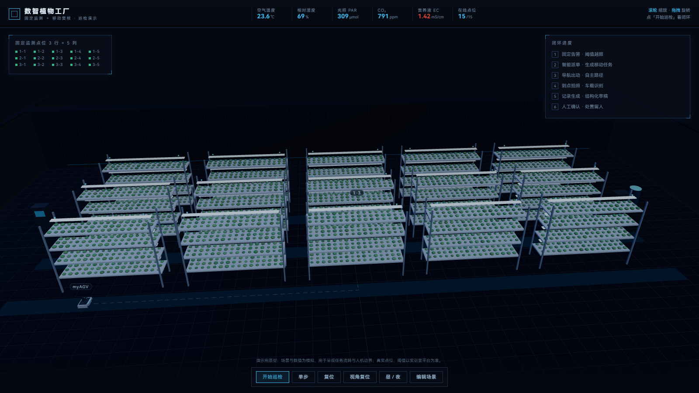
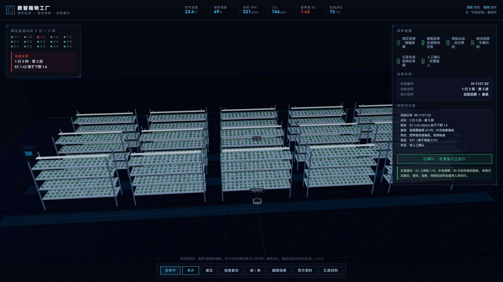
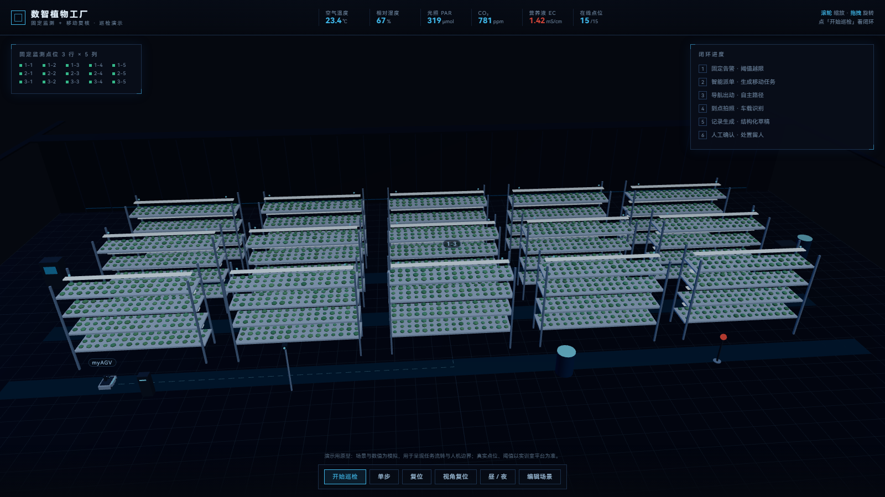
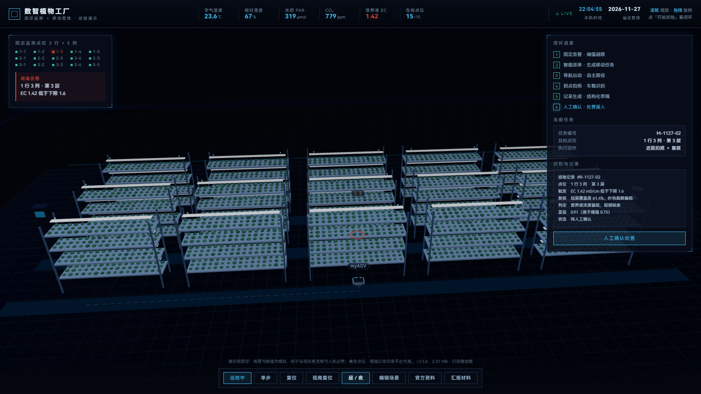
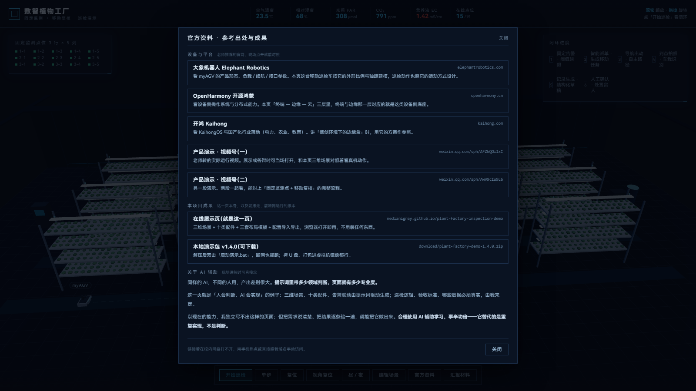
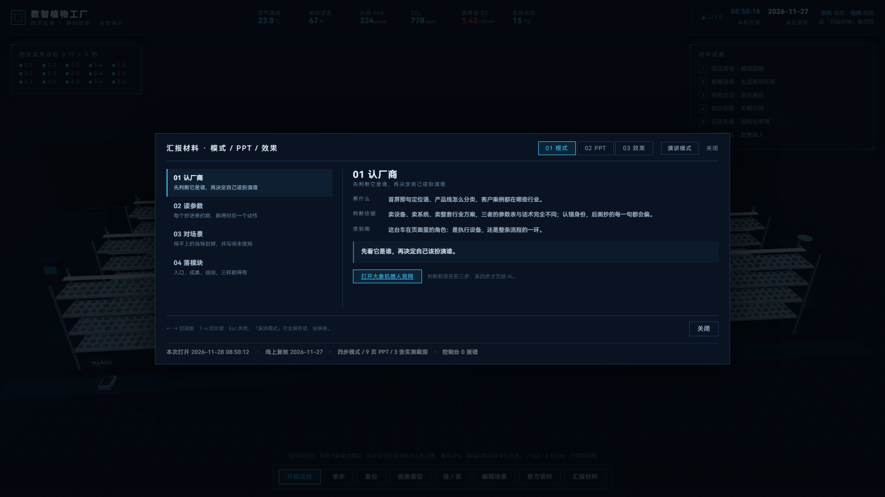

# 数智植物工厂 · 固定监测 ＋ 移动复核 智能巡检

把固定传感器的告警，接上移动小车的到点复核，让「发现异常」和「确认异常」接成一条线。

广西农业职业技术大学 信息工程学院 · 网络工程技术（本）2502 · 覃祖悦
人工智能课程 任务二（项目设计练习）配套 demo

**在线预览**：https://medianigray.github.io/plant-factory-inspection-demo/
**仓库地址**：https://github.com/MedianiGray/plant-factory-inspection-demo
**本地版下载**：[plant-factory-demo-1.6.0.zip](https://medianigray.github.io/plant-factory-inspection-demo/download/plant-factory-demo-1.6.0.zip)（解压后双击「启动演示.bat」，会用应用窗口打开；不依赖 GitHub 域名，校内网络也能下）



<table>
<tr>
<td></td>
<td></td>
</tr>
<tr>
<td></td>
<td></td>
</tr>
</table>

---

## 这是什么

一个单文件网页演示，双击 `index.html` 即开，**不需要联网**（3D 渲染库已内嵌在文件里），拷到 U 盘、换台电脑都能跑。

场景取材于实训室的数智植物工厂：多层立体水培（NFT 浅液流）、全光谱 LED。默认摆 **3 行 × 5 列共 15 个架位**，每架 4 层，行、列、层、株数、传感节点数都能在页面上改。页面里能点完一整条巡检链路：

| 步骤 | 页面上的表现 |
|---|---|
| 1 固定告警 | 告警点位所在层 EC 掉到 1.42，低于下限 1.6，左侧点位变红、告警框弹出、该点位出现红环闪烁 |
| 2 智能派单 | 右侧生成任务卡：任务编号、目标点位、执行动作 |
| 3 导航出动 | myAGV 从走道起点沿虚线开到目标列前的走道，再前进到架位正面 |
| 4 到点拍照 | 停车、车头朝架位、画面闪一下，（模拟）车载摄像头近距拍照识别 |
| 5 记录生成 | 右侧逐行出现结构化巡检记录：触发原因、覆盖度、判定、置信度 |
| 6 人工确认 | 点「人工确认处置」，给出处置建议，并写明动作由值班人员执行 |

### 场景是参数化的，不是画死的

点右下「编辑场景」，可以改：

- **架体阵列**：行数（1–3）、列数（1–6）、层数（2–5）、每层株数、每个架位挂几个传感节点。点「应用重建」后，架体、叶菜、传感节点、巡检路径、左侧点位表、3D 标签全部按新参数重新生成，相机也会自动退到能框住整排架位的全景位。
- **四个开关**：LED 补光灯带 / 车载摄像头 / 控制柜 / 水肥一体机。
- **告警点位**：指定哪一行哪一列报警，路径与记录文案跟着变。

### 配件是模块化的

配件采用「类型库 ＋ 实例」的做法：`PROP_TYPES` 里每类配件是一个 `make()` 工厂函数，实例只是一条 `{type, x, z, rot}` 记录。当前内置 **10 类**：声光报警器、充电桩、云台摄像头、储液罐、操作台、输送线、育苗苗床、分拣包装台、环流风机、CO₂ 补给。

- **放**：编辑面板点「＋ 某配件」→ 面板收起 → 点地面落位，Esc 取消，落位时鼠标变十字。
- **改**：已摆放的配件在列表里可以「旋转」（每次 90°）、「复制」（错开一位再生成一件）、「删除」。
- **扩**：要加新配件，只需在 `PROP_TYPES` 里补一条工厂函数，编辑面板的按钮会自动多出来，放置 / 旋转 / 复制 / 删除 / 导出导入全部自动生效，不用改其它代码。

### 场景能存档、能带走

- **布局模板**：标准苗床线 3×5 / 小试单排 1×3 / 密集育苗 3×6，一键换产线形态，已摆的配件保留。
- **导出 / 导入 JSON**：整份场景（阵列参数 + 四个开关 + 告警点位 + 全部配件坐标）存成一个文件，换台电脑、发给同学都能一模一样复现。导入走白名单校验，写坏的文件只会少几个配件，不会把场景搞崩。

### 本地版 / 在线版

| 方式 | 怎么用 | 适合 |
|---|---|---|
| 在线预览 | 打开 Pages 链接 | 交作业、手机看、发给别人 |
| 单文件 | 下载仓库里的 `index.html`，双击 | 任意一台电脑，离线 |
| 本地程序包 | 下载 Release 里的 zip，解压双击「启动演示.bat」 | 需要「像软件一样」交付、拷 U 盘带走 |

三种方式跑的是同一份页面，没有额外依赖。本地包里那个 bat 有 Edge 就 `msedge --app=…` 开一个应用窗口（没有标签栏、地址栏，看着就是个独立程序），没有 Edge 就退回系统默认浏览器。页面配置会自动存进浏览器 localStorage，下次打开还是上次的样子。

## 官网门面与网页版 PPT

老师给的那批官网，除了放进页面里的面板，还做成了两页可以直接投屏的东西，都在这套文件里：

| 文件 | 是什么 | 怎么用 |
|---|---|---|
| `official.html` | 官网门面（白底官网模式，不依赖任何照片）：首屏主张 + 点位示意图 → 三个盲区 → 这台车做／不做 → **在线演示（内嵌本页）** → 六步流程 → 参数与出处（可单独打印成 A4）→ 五层底座 → 四个载体 + 五个参考入口 → **怎么搬到另一个棚** → **取与不取** → 边界 | 双击打开；中间那块 16:9 框里就是 `index.html` 本体，可以直接操作，也可以全屏、重新载入 |
| `slides.html` | 网页版 PPT，十页 | 浏览器里翻页投屏：`←` `→` 翻页、`F` 全屏、`N` 看讲稿、`P` 打印；不需要飞书，不需要装 Office |

「取与不取」那一节是给老师看的对照表：每个入口取了什么（叫法、比例、流程、分层），明确没取什么（商品参数、板卡型号、企业案例），以及为什么没取。评审最容易追问的就是「你抄了官网多少」，这一节把答案提前摆出来。

官网页走的是老师给的那几个站点的模式：白底、大字、细线表格、一屏一件事。**整页不用一张照片**——首屏右侧是纯 CSS / SVG 画的三行五列点位示意图（09 号点位报异常、派单路径穿过 12 与 08），页面里唯一的"画面"就是中间内嵌的演示本体。

视觉按一套规范收口，不再每节临时决定：4 档间距（10/18/34/64/96）、3 档字号（主张 52 / 标题 27 / 正文 15）、1 个主色（#1257d8）只做强调、1 个图形语言（点阵 + 扫描线，仅出现在首屏点位图）、3 种容器（卡 / 表 / 一条细线行），并用两条浅色带（参数、迁移）把长页切出节奏。注释性的灰色小字全部删掉，导航从 8 项收到 5 项（方案 / 演示 / 参数 / 资料 / 迁移）。两处工程细节：三维演示改为**按需载入**（首屏不再等 2.4 MB，滚到第 3 节或点按钮才拉取），顶部有一条读进度的细线。设备名与指标仍然取自《用户操作手册（简化版）》《7 楼部分实训室介绍》与《数智植物工厂》建设方案，并且在第 5 节「参数，以及每个数字的出处」里逐行标了来源。平台账号、内部截图、运维口令，以及建设方案里尚未建成的效果渲染图，一律不取。

网页版 PPT 支持 `P` 直接打印：@page 设成 A4 横版，一页一张，讲稿自动附在每页页脚，交给老师就是十张纸，不用再导 PDF。

网页版 PPT 第 6 页专做「与真实方案对照」：左边写平台已有（场景联动、告警分级）、卡在哪一步（「需现场处理」没写谁去、去哪、怎么算处理完）、这页多走的（告警 → 任务卡 → 到点拍照 → 记录草稿 → 回到人），右边列建设方案里的硬指标（约 100 ㎡、NFT 浅液流 3–5 倍空间利用率、叶菜 25–40 天、茄果单层 ≥1.7 m、全光谱 LED 无级调光、八大实训模块含数字孪生）。这一页的作用，是把「没有重复造平台」这句话变成老师能逐条核对的两栏。

官网页第 8 节「怎么搬到另一个棚」回答的是复用性：点位表、告警阈值、记录字段各是一张表，换掉就能跑，三维场景按新棚尺寸重搭一次（约 1–2 天），真机对接不在这一版里。第 5 节参数表右侧带「打印参数页 P」按钮，会把整页切成 A4 竖版的一页（标题、来源、打印日期都在，其余节自动隐藏）；不点按钮直接 Ctrl+P 则打印整份官网。

网页版 PPT 与展示页同源：模式五页（五个入口分四类、四步走完一个、只取三处落地、与真实方案对照）、成品两页（载体同源）、效果两页（两块面板、线上实测字节数）加一页边界，共十页。页面体积与下载包体积都取自打包后的真实值，不写估算。

## 官方资料与出处（页面里点「官方资料」）



底栏右上有一个「官方资料」按钮，点开是独立面板，分三块：

**设备与平台**（老师推荐的官网，现场点开就能对照）

| 入口 | 看什么 | 与本页的关系 |
|---|---|---|
| [大象机器人 Elephant Robotics](https://www.elephantrobotics.com/) | myAGV 的产品形态、负载 / 续航 / 接口参数 | 本页移动巡检车按它的外形比例与轴距建模，巡检动作也照它的运动方式设计 |
| [OpenHarmony 开源鸿蒙](https://www.openharmony.cn/HomePage) | 设备侧操作系统与分布式能力 | 「终端 — 边缘 — 云」三层里的终端与边缘层，对应它的设备侧底座 |
| [开鸿 Kaihong](https://www.kaihong.com/) | KaihongOS 与国产化行业落地（电力、农业、教育） | 讲「信创环境下的边缘盒」时的参照方案 |
| [视频号演示（一）](https://weixin.qq.com/sph/AFZkQOiIxC)、[（二）](https://weixin.qq.com/sph/AwV9cIu9L6) | 真机实际运行 | 和本页三维场景对照着看，验证「固定监测点 + 移动复核」的流程 |

**本项目成果**：在线展示页（就是这一页）＋ 可下载的本地包 v1.6.0，断网也能跑。

**关于 AI 辅助**：同样的 AI，不同的人用，产出差别很大——提示词里带多少领域判断，页面就有多少专业度。这一页是「人会判断、AI 会实现」的例子：三维场景、十类配件、告警联动由提示词驱动生成，巡检逻辑与验收标准由作者定义。以现在的能力独立写不出这样的页面，但把需求说清楚、把结果逐条验一遍，就能做出来；AI 替代的是重复实现，不是判断。

## 汇报材料面板（页面里点「汇报材料」）



老师发的那批官网要拿到课上讲，光有链接不够。底栏这个「汇报材料」按钮，点开是一块**三页讲解器**（不是一叠静态图）：

**01 模式**：左侧四步纵向列表（认厂商 / 读参数 / 对场景 / 落模块），点选或按 `1`–`4` 切换；右侧详情卡给出「看什么 / 判断依据 / 落到哪」，再配一句可以照着念的话。前三步指向大象机器人、开源鸿蒙的官网，第四步直接跳到本页的「官方资料」面板。

**02 PPT**：十页网页版 PPT 的入口 + 页序对照（第 1–4 页模式、第 6 页方案对照、第 7–8 页成品、第 9–10 页效果），十个页码可以逐页跳；课堂上不依赖飞书，也不依赖 Office。

**03 效果**：三张实际截图（官方资料面板、到点复核、场景编辑），每张下面写「这张证明什么」；再往下是验收数字条——页面体积（浏览器自报）、三张截图全部内嵌、两块面板、控制台 0 报错。

面板右上还有**演讲模式**：六页全屏大字（开场 30 秒 → 四步 → 五条入口 → 两块面板 → 十页 PPT → 效果可核对），`←` `→` 翻页、`Esc` 退出，可以照着念着投。

## 时效与自检（页面自己报数）

这一页不做「已上线」式的宣告，能当场对的东西都放在明面上：

- **顶栏右侧 LIVE 条**：本机时间每秒跳动，旁边是最近复核日期。看一眼就知道这份页面是新的还是旧的。
- **底栏末尾**：本次加载的真实体积与耗时，由浏览器 `encodedBodySize` 直接读出，不写死；页面加了东西，这个数就跟着变。
- **汇报材料面板底部**：每打开一次打上当时的时间，连同「三页讲解器 / 10 页网页 PPT / 3 张实测截图 / 控制台 0 报错」一起写在行末。
- **截图都内嵌**：断网、拷 U 盘、投屏离线也看得到同样三张图，不依赖外链。

## 为什么需要它

固定侧能「持续盯着」，但有三处补不上的缺口：

- **点位盲区**：传感器按固定点位安装，多层架体之间、层内远端覆盖不到，环境数据代表的是「棚里的均值」，代表不了「这一株、这一层」。
- **确认盲区**：阈值告警只给「数值异常」，误报、设备故障、真实异常混在一起；告警之后仍然要人走到架位前用肉眼确认。
- **时间盲区**：人工巡检一天次数有限，夜间和无人时段异常发现滞后；固定摄像头视角不能移动，没法按需对可疑植株近距离特写。

移动侧补的正是「到点确认」这一环，而不是替代固定监测。**一台移动车共享给全部固定点位**，比每个架位加装一套固定摄像头成本低得多——这是本方案的核心取舍。场景从 3 个架位扩到 15 个之后，这个取舍更明显：固定端加了 12 个点位，移动端还是那一台车。

## 设计与取舍

完整版见 [`docs/design.md`](docs/design.md)，这里给结论：

- **五层架构**：设备层（固定传感器/摄像头、PLC 执行器、myAGV）→ 通信层（MQTT/Modbus、ROS2 DDS、鸿蒙分布式软总线）→ 平台层（物模型、场景联动、阈值告警、设备日志，实训室已有）→ 智能体层（任务派发、记录生成，本方案新增）→ 应用层（巡检看板、任务管理、记录确认）。
- **六项选型都写了放弃项**：ROS2 + NAV2 而非自研导航；Gazebo 而非只做静态演示；OpenHarmony QEMU 而非各设备各管一套入口；校内本地算力而非全走云端 API；复用现有识别能力而非自训新模型；大模型只派单与记录，**明确放弃让它直接控制设备**。
- **人机边界**：机器负责连续监测、派单、导航、拍照、记录草稿；人保留处置确认、阈值与判定口径校准、导航失败接管、记录终审。三条硬规则：置信度不足转人工、连续两次导航失败自动停车、高风险动作必须人工确认。

## 怎么用

1. 双击 `index.html`（或本地包里的「启动演示.bat」），等一秒进场景。
2. 点「开始巡检」自动走完六步；想一句一句讲就点「单步」。
3. 拖拽旋转、滚轮缩放；「视角复位」回全景位；「昼 / 夜」切换灯光。
4. 想换场景规模，点「编辑场景」改行列层，再点「应用重建」；也可以直接套用布局模板。
5. 想加设备，编辑面板点「＋ 输送线 / 苗床 / 分拣台 ……」，再点地面落位；列表里可旋转、复制、删除。
6. 讲人机边界时，停在第 6 步先不点确认，把「这一步该谁决定」抛给听众。

## 关于页面里的数字

页面上的温湿度、PAR、CO₂、EC、覆盖度、置信度都是**模拟值**，只用来呈现任务怎么流转、人机怎么分工，不代表实训室实测结果；真实点位、阈值以实训室平台为准。这个页面也**不是 Gazebo 仿真**——仿真验证走 ROS2 + Gazebo 那条线，属于下一步计划。

## 目录

```
index.html            单文件演示页（内嵌 three.js，离线可用；底栏「官方资料」「汇报材料」两块面板）
official.html         官网门面（中间 16:9 内嵌 index.html，被拦时给新窗口兜底）
slides.html           网页版 PPT 十页（← → 翻页、F 全屏、N 看讲稿）
download/             本地程序包 v1.6.0（Pages 直下，不依赖 github.com）
release/              本地程序包 zip 的本地副本
docs/design.md        方案设计与技术取舍
screenshots/          演示截图：全景 / 到点复核 / 场景编辑 / 配件近景 / 夜间
```

## 作者

覃祖悦 · 网络工程技术（本）2502 · 广西农业职业技术大学 信息工程学院
本项目仅用于课程学习与交流。
